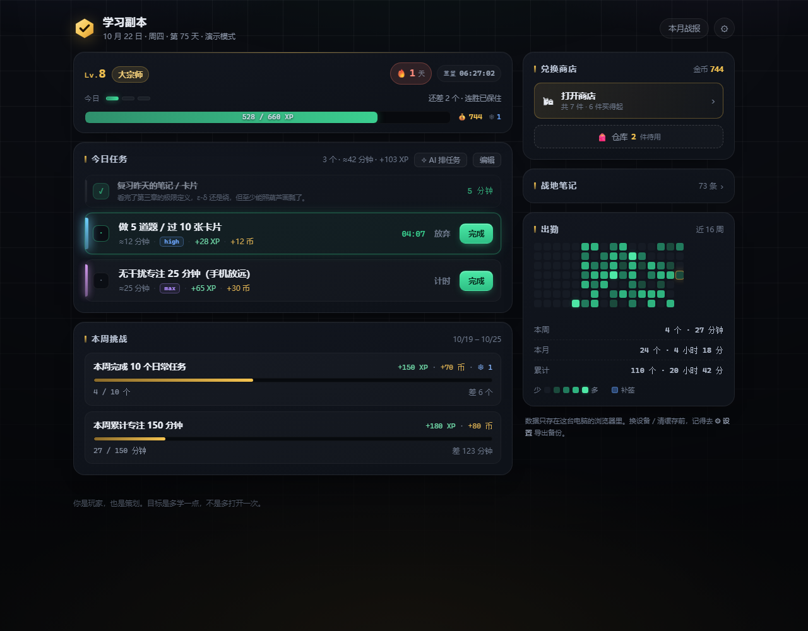
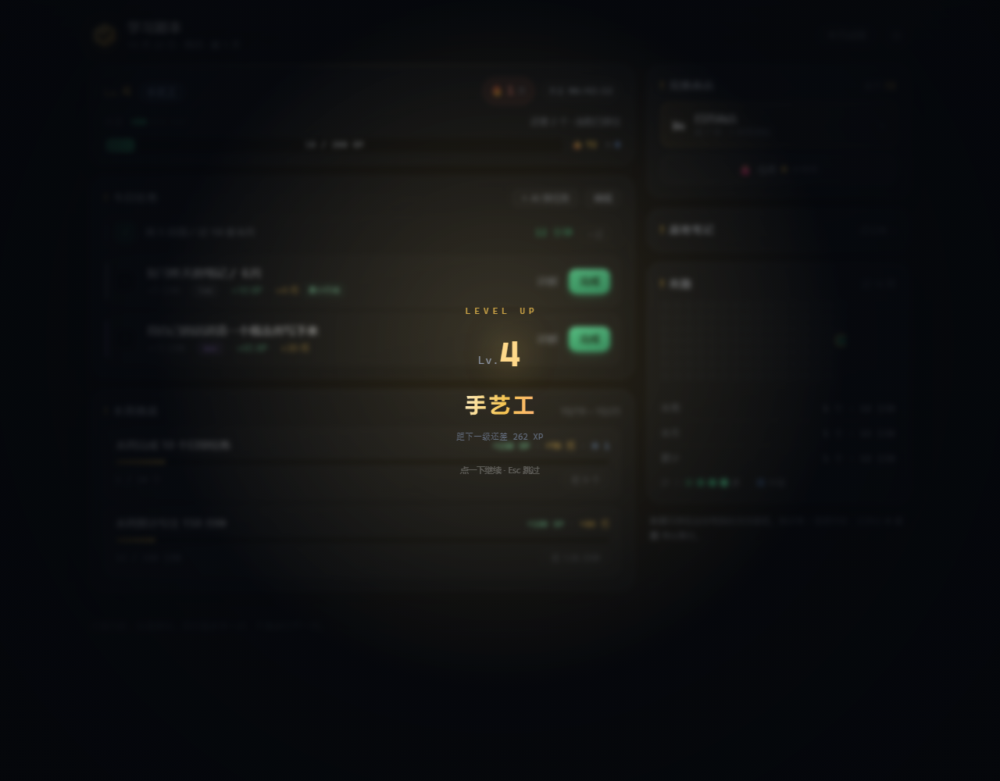
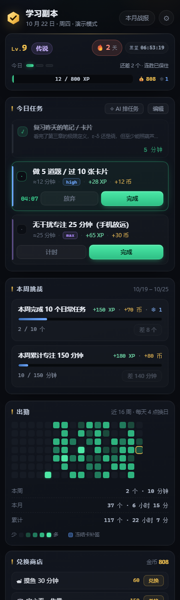

# 学习副本 · Study Dungeon

把学习做成日常任务 / 周常 / 连胜 / 冻结卡 / 兑换商店的**单机打卡站**。
零依赖、无后端、数据只存在你自己的浏览器里。



| | |
|---|---|
|  |  |

> 文里的 `YOUR-SERVER` 是占位符，换成你自己的服务器地址。

---

## 怎么打开

**线上（已经部署好了）**：<http://YOUR-SERVER/study/>

手机也能直接开，不用连同一个 Wi-Fi。

**本机**：

- 双击 `index.html`，浏览器直接打开就能用
- 或者在这个目录下 `pnpm dev`，然后开 `http://127.0.0.1:4321`

> 想看有数据的完整效果：地址后面加 `?demo=1`（演示数据单独存档，不会影响你的真实记录）。

> 注意：线上地址和本机地址是**两个不同的源**，各自存各自的数据。想两边同步就导出/导入备份。

---

## 文件

| 文件 | 作用 |
|---|---|
| `index.html` | 页面骨架 |
| `styles.css` | 全部样式（配色 / 圆角 / 间距都在 `:root` 里） |
| `app.js` | 全部逻辑，**要改任务和奖励就改这里顶部的 `CONFIG`** |
| `server.mjs` | 只为 `pnpm dev` 准备的极简静态服务器，可以不管 |
| `manifest.json` / `sw.js` / `icon-*.png` | PWA：装到主屏幕 + 离线缓存 |
| `tools/make-icons.py` | 生成上面三个图标（换了 logo 就重跑一次） |
| `sync/server.py` | 云同步服务端（Python 标准库，零依赖），跑在服务器上 |

---

## 每天怎么用

打开先看到一个**启动画面**：六边形金色的「对勾」标记 + 标题 + 一根细线，点「开始游戏」后，一条进度条**从两头同时往中间填**，百分比卡在正中间（明日方舟那味儿），大概两秒走完，点一下能跳过。

进去之后是 3 条任务——从 6 条预置任务里按日期抽的，天天不太一样。

1. 觉得不合适就点「编辑」改；想固定成自己的一套，保存时勾 **「以后每天也用这套」**，之后就不再随机抽了。
2. 点「计时」开始计时（不点也行，直接做完点「完成」，按预估时长记账）。
3. 点「完成」→ **立刻结算**：经验球和金币会飞进上方的栏里，进度条和数字滚起来。不弹窗、不用填任何东西。
4. 完成**任意 1 个**就保住连胜，不用全清。

**懒得想任务？** 点「✧ AI 排任务」，随便写一句「今天数学看完第三章，英语背 50 个单词，晚上做一套真题」，它给你拆成带等级的任务，确认后一键替换今天。

**改任务还有奖励**：每天第一次保存编辑，本身给一份 `high` 奖励（+28 XP · +12 币）。一天只给一次。

**想留个记录？** 完成之后那一行会出现「＋ 顺手记一句（可选）」，敲一句回车就存。空着不写，奖励一分不少。

**兑换的奖励不想马上用？** 兑换后先进「仓库」，想用的时候再点「用掉」。攒着不会过期。

「本周挑战」按自然周（周一起）自动累计，达标后点「领取奖励」。

---

## 界面上的几块

**背景**：一层细网格 + 一层慢速漂移的环境光，四周有暗角压着。环境光颜色按时段换——凌晨偏暖、白天偏冷、傍晚偏红、深夜偏紫。背景底部还有一层「进度光」，亮度等于今天的完成度：0 个任务时几乎看不见，全清之后整页下半截会微微暖起来。不想要网格可以在 ⚙ 里关掉（「背景网格」），关掉就是纯黑。

**顶部那条是「今日预算」**，不是四个数字堆：

```
Lv.9 传说                    🔥 1 天   重置 06:57:03
今日 ●●○                      还差 2 个 · 连胜已保住
3 / 800 XP  ████░░░░░░              💰 802  ❄ 1
```

- 中间那排小点 = 今天的任务，亮几个就是做完几个，余光扫一眼就知道还剩多少
- 右边倒计时是**距下一次换日**（凌晨 4 点），剩不到 1 小时会变金色
- 经验条是小字那条，金币/冻结卡缩到右边，不再各占一个方块

**周常是个宝箱**：达标之后进度条会变成 🎁，标题旁边亮一个红点；点开先摇一下再结算，红点跟着消失。宝箱里除了 XP/金币，有一个日常给不了的东西——**冻结卡**。

**商店是折叠的**：右侧只有一个「打开商店」入口（带金币和"几件买得起"），点开是悬浮窗，两列铺开。仓库入口在入口卡片上，商店弹窗里也有一个，兑换完不用来回关。

**笔记默认折叠**：右侧只显示「战地笔记 · N 条」，点一下才展开。不想写就永远不用展开——它不影响任何奖励，只是给愿意写的人留的一个口子。

**全部做完有结算**：三条任务清完，列表顶上会出现一块绿色的「今日通关 · 3 个 · 34 分钟 · +103 XP · 明天 04:00 刷新」，下面保留完成记录。一天结束得有个句号，不然关掉页面像是没做完。

**等级称号会变色**：Lv.1–2 灰、3–4 蓝、5–6 紫、7–8 金、9–10 烫金。称号本来就是"你现在是谁"，不该一直是同一个紫色。

**顶栏有「第 N 天」**：从最早有记录的那天开始算。这是唯一一个"只增不减"的数字，断了连胜也不会归零。

**升级是一屏的事**：跨过等级线时，整个页面会暗下来、金色光环扩散，中间打出 `LEVEL UP / Lv.4 / 手艺工 / 距下一级还差 262 XP`。2.6 秒自动收，点一下或 `Esc` 立刻跳过。以前只有一行小 toast，配不上它在这套系统里的分量。

---

## 任务等级

任务的 XP 和金币不再手填，选一个等级就行：

| 等级 | 含义 | XP | 金币 | 大约耗时 |
|---|---|---|---|---|
| `low` | 小试——5 分钟就能开始 | 10 | 4 | 5 分钟 |
| `high` | 推进——正常的一天 | 28 | 12 | 20 分钟 |
| `max` | 硬仗——需要专门腾时间 | 65 | 30 | 45 分钟 |
| `astra` | 突破——啃下最硬的那块 | 150 | 75 | 2 小时 |
| `原神牛逼` | 传说——里程碑（一章 / 一本书 / 一个项目） | 380 | 200 | — |

定价的三个考虑：

- **`low` 每单位时间的经验最高**。这是故意的：5 分钟能开始，比"今天算了"重要得多。
- **越往上金币占比越高**（0.40 → 0.53）。经验只影响等级，金币能换真东西，所以硬仗给更多金币。
- **总量对得上**：日常池平均 34 XP / 15 币，一天 3 个 ≈ 100 XP / 46 币。一杯奶茶 250 币 ≈ 攒 5 天，满级 ≈ 5 周。改等级数值等于改整个经济，改之前先按这条算一遍。

`astra` 和 `原神牛逼` 默认不在任务池里——它们的意义是"你自己决定今天算不算一场大仗"。

---

## AI 拆任务

点「今日任务」右上角的「✧ AI 排任务」，用大白话写一句：

> 今天数学要把第三章看完，英语背 50 个单词，晚上做一套真题，再整理一下错题

它拆成四条：

- `max` 数学要把第三章看完 · 60 分钟
- `high` 英语背 50 个单词 · 20 分钟
- `astra` 做一套真题 · 120 分钟
- `high` 整理一下错题 · 15 分钟

确认后**加进**今天的任务列表（不会覆盖你已经有的），重名的会自动跳过。

**还能说话**：输入框旁边有个「🎤 语音输入」（浏览器支持时才出现），按一下直接说，说完点「拆成任务」。麦克风只在**安全上下文**下可用，见下面「手机上用」。

**两种模式：**

| | 不填 Key（默认） | 设置里填了 Key |
|---|---|---|
| 怎么拆 | 内置的本地规则：按标点切句、按关键词猜等级、按数字猜时长 | 调 OpenAI 兼容接口，让模型拆 |
| 联网 | 不需要 | 需要 |
| 花钱 | 免费 | 花你自己的 token |
| 效果 | 够用，偶尔把「数学」塞进标题里 | 明显更好 |

Key 存在本机 `localStorage`，请求直接从浏览器发到你自己填的地址，不经过任何中间服务器。**但它是明文存的**，别在公用电脑上填。接口不通会自动退回本地规则，不会卡死。

---

## 手机上用

**最简单的**：手机浏览器直接开 <http://YOUR-SERVER/study/>，不用同一个 Wi-Fi，也不用开电脑。

**如果走本机开发**（`pnpm dev`），服务器现在监听所有网卡，启动时会把手机能用的地址打出来：

```
  学习副本
  本机   http://127.0.0.1:4321
  手机   http://192.168.x.x:4321    (WLAN)
```

手机连**同一个 Wi-Fi**，浏览器打开那个 http 地址即可。

打不开就按顺序排查：

1. **不是同一个网络**——手机走的是流量，或者连了另一个 Wi-Fi。
2. **防火墙**——首次运行 Windows 会弹窗，要选「专用网络」允许；没弹窗就用管理员执行：
   `netsh advfirewall firewall add rule name="study-dungeon" dir=in action=allow protocol=TCP localport=4321`
3. **校园网 / 公共 Wi-Fi 开了客户端隔离**——设备之间互相访问不了。换手机热点，或者用下面的 Tailscale。
4. **装了 Tailscale**：电脑和手机登录同一账号，手机直接开 `http://<电脑的 100.x 地址>:4321`，跨网络也能连。

### 关于手机麦克风

语音输入用的是 Web Speech API，**浏览器只在「安全上下文」下给麦克风**：

| 打开方式 | 语音能用吗 |
|---|---|
| 电脑上 `http://127.0.0.1:4321` | ✅ 能（localhost 算安全） |
| 手机 `http://YOUR-SERVER/study/` | ❌ 不行，http 一律拒绝 |
| 手机 `https://...`（正式证书 / 隧道） | ✅ 能 |

想让手机也能说，两条路：

- **Chrome 临时放开**：手机 Chrome 打开 `chrome://flags/#unsafely-treat-insecure-origin-as-secure`，把站点源加进去，重启浏览器。
- **给个 https**：服务器上已经有 443（自签证书），可以试试 `https://YOUR-SERVER/study/`，接受证书警告后再点麦克风——但自签证书到底算不算"安全上下文"各浏览器不一样，不保证。真要用，配个正式证书最稳。

打不了字的时候，吐槽一句「http 不给麦克风」是浏览器的锅，不是这个页面的锅。

---

## 部署（已经在跑）

线上地址：**<http://YOUR-SERVER/study/>**

没有构建步骤，就是三个静态文件。链路长这样：

```
浏览器 → 你原有的 ad-nginx :80
           └─ /study/   →  proxy_pass  →  study-dungeon 容器（nginx:alpine，内部 80）
                                              └─ 只读挂载 /opt/study-dungeon
```

| 东西 | 在哪 |
|---|---|
| 站点文件 | 服务器 `/opt/study-dungeon/`（index.html / styles.css / app.js） |
| 容器 | `study-dungeon`，`--restart unless-stopped` |
| 反代配置 | `/srv/campus-ad/nginx/default.conf` 里的 `location /study/` |
| 配置备份 | 同目录 `default.conf.bak-<时间戳>` |

**更新一版**（改完本地文件后）：

```bash
scp index.html styles.css app.js root@YOUR-SERVER:/opt/study-dungeon/
```

不用重启：容器是 bind mount，刷新页面就生效。

> 如果页面没变，刷新两次 —— Service Worker 会先给旧缓存，同时在后台拉新的。真卡住了就 DevTools → Application → Service Workers → Unregister。

**几个踩过的点：**

- 本来想直接开 `8090` 端口跑独立服务，但腾讯云安全组只放行了 80/443/8000/8080，8090 外网不通；而 80 已经被 ad-nginx 占了，所以改成子路径反代。
- 服务器上 ufw 只开了 22，但 Docker 的 iptables 规则绕过 ufw——所以真正拦住 8090 的是云安全组，不是服务器防火墙。
- 反代配置是 bind mount 进容器的，改完 `nginx -t` 通过再 `nginx -s reload`，不用重建容器、不影响你原来的 ad 后台。

---

## 改商城

设置 →「编辑商品」：改名字、改价格、加自己的奖励、删掉不想要的冻结卡之外的东西。保存后商店和仓库立刻生效。

价格自己定，参照系：一天 3 个任务大约 46 金币，一杯奶茶 250 币 ≈ 5 天。

---

## 仓库

**兑换不等于用掉。** 花金币兑换的奖励会先进仓库：

- 仓库里能看到攒了几件、什么时候兑换的
- 点「用掉一个」才算真正兑现，然后才会进「已经享受过的」
- 一次性兑换多件会堆在一起显示数量

这样设计是因为：想喝奶茶的时候未必能立刻喝，但"我账户里还躺着两杯"本身就是一种动力。

---

## 怎么改成你想要的样子

打开 `app.js`，最上面就是 `CONFIG`：

```js
dailyCount: 3,          // 从预置池里抽几个
grades: {...},          // 五个等级的 XP / 金币定价
gradeOrder: [...],      // 等级从低到高的顺序
daily: [...],           // 预置任务池：title / minutes / grade / quick
weekly: [...],          // 周常：kind=count 或 minutes, target
levels: [...],          // 等级表：累计经验 + 称号
shop: [...],            // 默认商品；在设置里改过之后以你改的为准
freezesAtStart: 2,      // 初始送几张冻结卡
studyDayStartHour: 4,   // 几点算换日
```

改完保存，刷新页面即可。**不用装任何东西，没有构建步骤。**

几条改配置的经验：

- **任务按「产出」写，别按「时长」写**。「学 2 小时」会让你摸鱼凑时间，「看完 3.2 节并写 5 行笔记」没法糊弄。
- **价格表要真能兑现**。一杯奶茶 250 币，按每天 3 个任务算大约 5 天能攒到——这个节奏才对。定得太便宜，金币会通胀到毫无感觉。
- **界面里定的任务存在 `customDaily`**（勾了「以后每天也用这套」的那份），`CONFIG.daily` 是没人定过时用的预置池。两套不冲突：有 `customDaily` 就只用它。

---

## 机制说明（为什么这么设计）

- **一天从凌晨 4 点开始**：熬夜学习的人不会在 0 点被莫名其妙断签。
- **连胜只看「有没有完成 1 个」**：要求全清的话，某天忙到只能做 5 分钟，就会直接放弃整个系统。
- **冻结卡**：断签时自动消耗 1 张补签，连胜不清零。这是这套系统里最重要的一个机制——没有它，断一次就等于永久流失。
- **周常有两种**：数量型（完成 10 个）和累积型（150 分钟），一个防止单日爆肝、一个防止只做最简单的任务。
- **笔记是可选的一行**：不拦你，但完成之后会顺手问一句。这是唯一能对抗「三个月后不知道自己有没有进步」的东西，值得偶尔写。
- **任务可以当场改**：抽到不合适的就顺手改掉——改不动的东西，用两天就会被无视。
- **金币只能换现实奖励**：等级和称号靠经验、只增不减，所以不会通胀；金币换的是奶茶、番剧、游戏时间——虚的东西会贬值，真的东西不会。
- **换来的东西先入库，用掉才算数**：兑换只是"买下了"，用掉才是"享受了"。中间那一步可以放很久，这让攒金币变得有意义。

---

## 数据与备份

数据存在浏览器的 `localStorage`，键名 `study.dungeon.v2`。

- **换浏览器、清缓存、换电脑 = 数据没了**。
- 所以：点右上 ⚙ → 「导出备份」，会下载一个 `.json`。换设备后用「导入备份」恢复。
- 建议每周导一次，丢在网盘里。

**自动兜底**：每次保存前会把上一版挪到 `study.dungeon.v2.prev`。万一主档哪天读不出来（存储损坏、扩展写坏），打开时会自动退回上一份并提示一句，原始数据另外留在 `study.dungeon.v2.broken.<时间戳>` 里，不会直接扔掉。这是兜底，不是备份——真丢了还是得靠导出的 `.json`。

### 把本机数据搬到线上

存档在**浏览器**里，不在服务器上——所以线上地址打开是一份全新的档。要把本机的进度搬过去：

1. 本机打开 `http://127.0.0.1:4321`（或双击 index.html），点右上 ⚙ →「导出备份」，得到一个 `.json`
2. 线上打开 <http://YOUR-SERVER/study/>，点 ⚙ →「导入备份」，选刚才那个文件
3. 导入成功会提示「已导入：Lv.X · N 金币 · M 天记录」，检查一下等级和金币对不对

反方向（线上 → 本机）同理。

> 做不到自动同步，是因为数据在各自的浏览器里，两个地址等于两个独立的 App。想让手机和电脑共用一个进度，得加一个很小的后端（服务器上一个 JSON + 一个口令），需要的话可以说。

---

### 关于那次重置

这一版换成了新的存档键 `study.dungeon.v2`，所以旧的任务记录、等级、金币不会再被读取——等于开了一个新档。

**旧档没有删**，还在 `localStorage` 的 `study.dungeon.v1` 里。真想要回来的话，把 `app.js` 里 `KEY` 的 `v2` 改回 `v1`，刷新即可。

---

## 云同步（手机 / 电脑共用一份进度）

默认没有后端，数据各自在浏览器里。打开云同步之后，进度存在你自己的服务器上：

```
浏览器 ⇄ /study/api/state ⇄ study-sync 容器 ⇄ /srv/study-data/state.json
```

**每台设备配一次**：⚙ →「云同步」→ 打开开关 → 填服务器地址和口令。

- 服务器地址：`http://YOUR-SERVER/study/api`（从线上地址打开时自动填好）
- 口令：服务器上 `/srv/study-data/token` 的内容，取法
  `ssh root@YOUR-SERVER cat /srv/study-data/token`

**它会怎么同步**：

| 场景 | 行为 |
|---|---|
| 改任何东西 | 0.8 秒后自动推送；推不上去（离线）就记成「有改动还没传」 |
| 打开页面 | 自动拉一次；本机没有未上传的改动时，才切到服务器版本 |
| 服务器空的、本机有数据 | 自动上传 |
| **两边都有新东西** | **不替你选**，弹面板：用本机覆盖服务器 / 用服务器丢掉本机 |
| 点「上传本机」 | 问一句后强制覆盖服务器 |
| 点「拉取服务器」 | 本机有未上传改动时会先弹冲突面板，不会静默丢掉 |

**几个实话**：

- 站点是 http，口令是明文传的。一个人用问题不大，介意就套 https
- 只做整体覆盖，不做逐条合并：两台设备都离线改了同一天，只能留一边（所以给了冲突面板，至少不会悄悄丢）
- **API Key 不参与同步**：推送前会被剥掉，只留在你设备本地。换设备要重新填一次
- 关掉同步不影响本机数据

**快照**：每次写入都会在 `/srv/study-data/snapshots/state-<rev>.json` 留一份，只保留最近 10 份。手滑覆盖了想回滚：

```bash
ssh root@YOUR-SERVER
cd /srv/study-data
ls snapshots/                     # 看看有哪几版
cp snapshots/state-000042.json state.json
docker restart study-sync
```

**换口令**：改 `/srv/study-data/token` 的内容 → `docker restart study-sync` → 所有设备重新填一次。

---

## 装到手机上（PWA）

`manifest.json` + `sw.js` + 三个尺寸的图标，已经配好：

- 安卓 Chrome / 桌面 Chrome：地址栏右侧出现「安装」，或菜单里「添加到主屏幕」
- iPhone Safari：分享 →「添加到主屏幕」，用 `apple-touch-icon` 当图标
- 装好后全屏无地址栏，断网也能打开（SM 缓存了 index/styles/app）

**前提：必须是 https 或 localhost。** 浏览器不给 http 站点注册 Service Worker。

现在线上是 `http://YOUR-SERVER/study/`，所以：

| 打开方式 | 能装 | 能离线 |
|---|---|---|
| `http://YOUR-SERVER/study/` | 只能建个普通书签快捷方式 | 不行 |
| `https://…`（证书有效） | ✅ 真 PWA | ✅ |
| 电脑 `http://127.0.0.1:4321` | ✅ | ✅ |

想要真 PWA，两个办法：给服务器配个域名 + Let's Encrypt 证书，或者用 `cloudflared tunnel` 之类套一层 https。现在的 443 是自签证书，浏览器会拦 Service Worker，不算数。

---

## 每日提醒（服务器在催你）

服务器上装了一个 systemd timer，每 10 分钟看一次「今天有没有完成」，没有就在 20:30 之后催一次。

**当前通道：PushPlus（微信）**

- 消息会出现在微信的「pushplus」服务号里
- token 存在服务器 `/srv/study-notify/config.json`（权限 600），没写进这个文件
- 发送前会校验返回码，PushPlus 出错时虽然 HTTP 也是 200，但 `code != 200` 会直接报错，不会假装发成功

**为什么是服务号发的**：微信不允许第三方应用直接给个人发消息，唯一正规通道是「公众号模板消息」。PushPlus 用自己的认证服务号转发，所以发件人显示成它，不是「学习副本」。自己注册公众号走不通——个人主体只能注册订阅号，订阅号不支持模板消息。

想要「自己的名义」只有两条路：企业微信群机器人（自己的群、自己的机器人），或者干脆不走微信、用 Bark / ntfy 这类原生推送 App。当前选择继续用 PushPlus，微信里把 `pushplus` 那个会话**置顶**，就不会漏。

**什么时候会吵你**：

| 条件 | 行为 |
|---|---|
| 今天已经有完成记录 | 不打扰 |
| 今天已经催过一次 | 不重复催 |
| 还没到 20:30 | 不打扰 |
| 过了 23:30 | 静默，不半夜叫你 |
| 服务器上没有同步数据 | 跳过（得先开云同步才判断得出来） |

「今天」按凌晨 4 点换日，和 App 里一致。

消息第一行会被当成通知标题，所以固定带名字：

```
学习副本 · 今天还没开张
6 天连胜要断了。真想保命的话，做个 5 分钟的 low 任务也算数。
（你还有 2 张冻结卡，但别拿它当日常）
还有 2 小时 43 分 · http://YOUR-SERVER/study/
```

**换成你习惯的通道**：一条命令，不用手改 JSON。

| 通道 | 命令 | 去哪拿凭证 |
|---|---|---|
| **PushPlus（微信）** | `python3 notify.py --setup pushplus <token>` | pushplus.plus 微信扫码登录 → 复制 token，免费 200 条/天（当前用的） |
| **Server酱（微信）** | `python3 notify.py --setup serverchan <SendKey>` | sct.ftqq.com 微信扫码 → 拿 SendKey，免费 5 条/天 |
| **企业微信机器人** | `python3 notify.py --setup wecom <webhook地址>` | 企业微信建个群 → 群设置 → 群机器人 → 复制 webhook，**不限量** |
| **QQ 邮箱** | `python3 notify.py --setup email <QQ号@qq.com> <授权码>` | QQ 邮箱设置 → 账户 → 开启 SMTP → 生成授权码 |
| `ntfy` | `python3 notify.py --setup ntfy <topic>` | 不用注册 |
| 任意 webhook | `python3 notify.py --setup webhook <url>` | 钉钉 / 飞书 / Slack，POST `{"text": "..."}` |

切完立刻验证一条：

```bash
python3 /srv/study-notify/notify.py --test
```

`--test` 会真发一条「测试消息：这条能收到，说明通知通道是通的。」+ 应用地址。收到就说明通了。

其他常用操作：

```bash
python3 /srv/study-notify/notify.py --dry    # 只看判断，不发
journalctl -u study-notify.service -n 20     # 看最近几轮日志
systemctl list-timers study-notify.timer     # 下次什么时候跑
```

> Telegram 从这台服务器连不上（api.telegram.org 直接超时），所以没做这个通道。

---

## 已知边界（第一版故意没做）

- 没有账号体系：云同步靠一个共享口令，不分用户，也没做端到端加密。
- 没有推送提醒（可以自己在手机上加个闹钟，或者把页面固定成浏览器标签页）。
- 没有排行榜（单人使用，社交压力容易反噬）。
- 防作弊只到「自己点完成 / 自己开计时」这一档，没有验证。真要防自己，得接截图 OCR / Anki 导出校验，工程量爆炸，先别碰。

## 如果还想往下做

1. **PWA**：加个 `manifest.json` + service worker，就能「添加到主屏幕」，像个 App。
2. **手机提醒**：`Notification API` + 一个固定的打开时间。
3. **赛季**：30 天一个赛季，结束时生成一张可截图的总结卡片。
4. **知识点复盘**：把每天的笔记按关键词聚合，月底告诉你「这个月你卡在哪儿」。

---

## 最后一句

别问「功能全不全」，只问一个问题：

> 连续用 7 天，第 8 天你有没有主动想打开的冲动？

没有的话，问题在机制（任务太难 / 连胜太脆 / 奖励不真实），不在界面。去改 `CONFIG`，别去加动画。

---

## 许可

[MIT](LICENSE) © 2026 Martinlee-123

